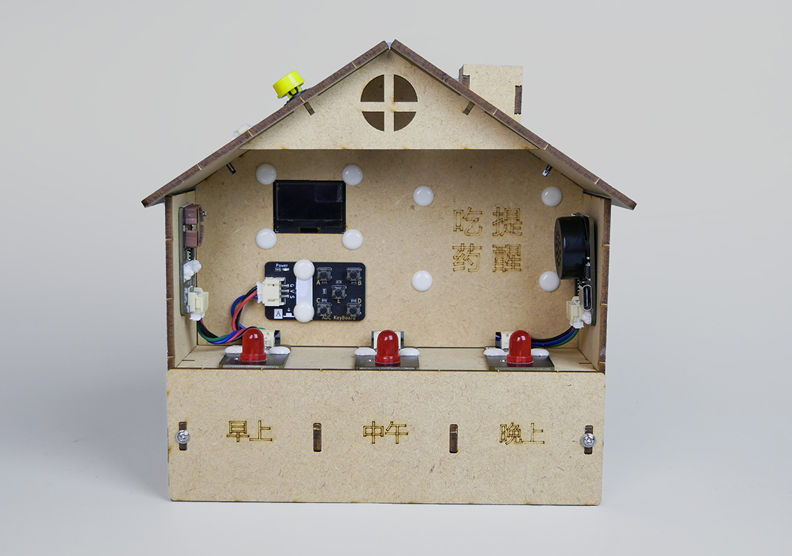
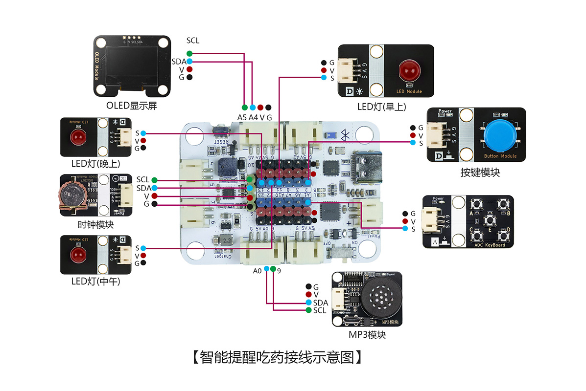
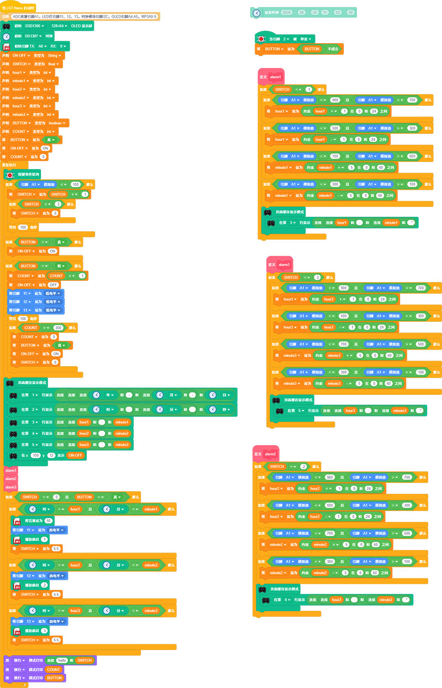
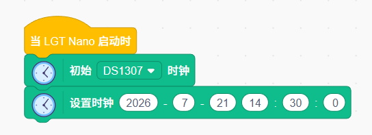

# 智能提醒吃药

## 产品概述

智能提醒吃药是一款由 LGT maker-nano 主板、DS1302 时钟模块、ADC 按键模块、MP3 模块、独立按键模块、3 颗红色 LED、OLED 显示器组合而成的 STEM 手工拼装套件。套件可实现精准定时吃药提醒，支持自定义早、中、晚三组服药时间，OLED 实时展示当前时间与预设提醒时段；到达设定时间后 MP3 播放语音提醒服药，对应红色 LED 点亮提示对应药盒抽屉；按下实体按键即可关闭本次提醒。通过制作该作品，能够学习实时时钟计时、按键逻辑调节、OLED 图文显示、语音播放、灯光指示等单片机控制知识，理解定时触发控制系统原理，培养时间管理与智能定时设备研发兴趣。
 

## 产品参数

| 参数 | 规格 |
|:----:|------|
| 型号 | zmf-0003 |
|   制作类型   | 手工拼装、采用螺丝紧固结构 |
| 使用环境 | -10℃ ~ +50℃ |
| 供电方式 | TYPE-C USB端口，供电电压5V |
| 产品尺寸 | 165x82x158mm |
| 核心主板 | LGT maker-nano 主板 |
| 硬件模组 | DS1302 时钟模块、ADC 按键模块、MP3 语音模块、独立按键模块、3 个红色 LED 指示灯、OLED 显示器 |
| 支持编程软件 | Blockcode（图形化编程+无线下载）、Mixly、Arduino |
| 结构材质 | 厚度2.5mm进口奥松板 |

 

## 功能特性

- 多时段定时设置
  - 通过 ADC 按键可自定义早、中、晚三组独立吃药提醒时间，适配一日三次服药需求。
- 实时时钟显示
  - DS1302 提供精准计时，OLED 屏幕同步显示设备当前时间与三组预设提醒时间，信息一目了然。
- 语音声光同步提醒
  - 到达预设服药时间，MP3 模块播放吃药语音提示，对应红色 LED 灯常亮，指示对应药盒抽屉药品。
- 一键关闭提醒
  - 触发提醒后，按下独立按键模块可直接关闭本次语音与灯光提醒。
- 多功能 ADC 按键调节
  - E 键切换待设置时段；A、C 键调节小时数值增减；B、D 键调节分钟数值增减，操作简单易懂。
- 支持无线下载：直接通过蓝牙下载程序，方便调试和更换控制代码。

   

## 工作原理

设备上电后 DS1302 时钟模块持续运行计时，OLED 实时刷新展示当前系统时间与三组预设服药时间。使用者通过 ADC 按键进入时间设置界面：E 键切换早 / 中 / 晚三个提醒时段，A/C 键调整时钟，B/D 键调整分钟，修改后的时间自动保存。当系统实时时间与任意一组预设提醒时间匹配时，主控板触发 MP3 模块播放服药语音，同时点亮对应时段的红色 LED 指示灯，提示用户取出对应抽屉药品；用户按下实体按键后，语音停止、LED 熄灭，本次提醒结束。整套装置集时钟计时、参数调节、屏幕显示、语音播报、灯光指示于一体，完整演示定时提醒类智能设备控制逻辑。

 

## 使用说明

### 材料清单

| 名称              | 数量 | 名称            | 数量 | 名称                | 数量 |
| ----------------- | ---- | --------------- | ---- | ------------------- | ---- |
| LGT maker-nano    | 1    | DS1302 时钟模块   | 1    | 	MP3 语音模块 | 1    |
|OLED 显示器   | 1    | ADC 按键模块 | 1    | 按键模块  | 1    |
| 红色 LED 灯     | 3    | 椴木结构板  | 2    |   PH2.0转杜邦4pin线    | 1    |
| PH2.0转杜邦3pin线 | 5    | PH2.0双头4pin线 | 2    | 扎线带 | 3    |
| TYPEC-数据线      | 1    | 2pin-ph2.0单头   | 1    | 热缩管          | 3    |
| 塑料铆钉4070    | 24   | 塑料铆钉4120    | 3    | 2.3*6mm自攻螺丝     | 16  |
| 螺丝刀     | 1    |  

### 实物连接图

### 接线示意图

 

### 产品程序

[软件下载与安装](docs/software/installation.md)

[Blockcode程序加载与上传](docs/software/blockcode/Upload.md)

程序下载：
<a href="docs/LGT-Nano系列/zmf-0003-智能提醒吃药/程序/0003-智能吃药提醒-blockcode.rar" download>0003-智能吃药提醒-blockcode</a>

音频下载：
<a href="docs/LGT-Nano系列/zmf-0003-智能提醒吃药/0003-智能提醒吃药-音频.rar" download>0003-智能提醒吃药-音频</a>
 

### 初次使用操作步骤
1. 用TYPE-C 数据线将MP3模块连接电脑，将音频按照顺序依次复制到MP3模块的内存中。

2. 用TYPE-C 数据线将主板连接电脑，在软件端打开“设置时钟”程序，在程序中输入当前时间，并上传程序，完成系统时间校准；

3. 软件端打开并上传“智能吃药提醒-主程序”程序；
4. 操作 ADC 按键设置早、中、晚三组吃药提醒时间：
   * E 键：循环切换早、中、晚三个待设置时段；
   * A 键、C 键：对选中时段的小时数值进行加、减调节；
   * B 键、D 键：对选中时段的分钟数值进行加、减调节；
5. 设置完成后自动保存，OLED 持续显示当前时间与三组提醒时间；
6. 到达预设提醒时间，MP3 播放吃药语音，对应红色 LED 点亮；按下按键，即可关闭本次语音灯光提醒。

### 组装教程

组装视频教程请移步公众号，扫码关注一下

