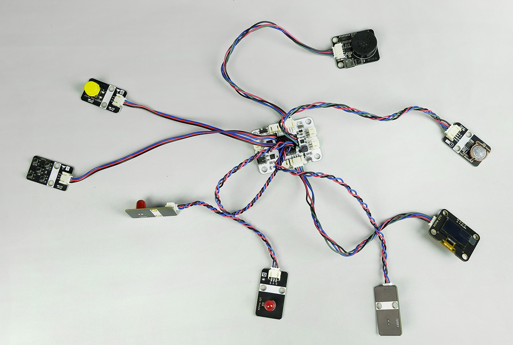
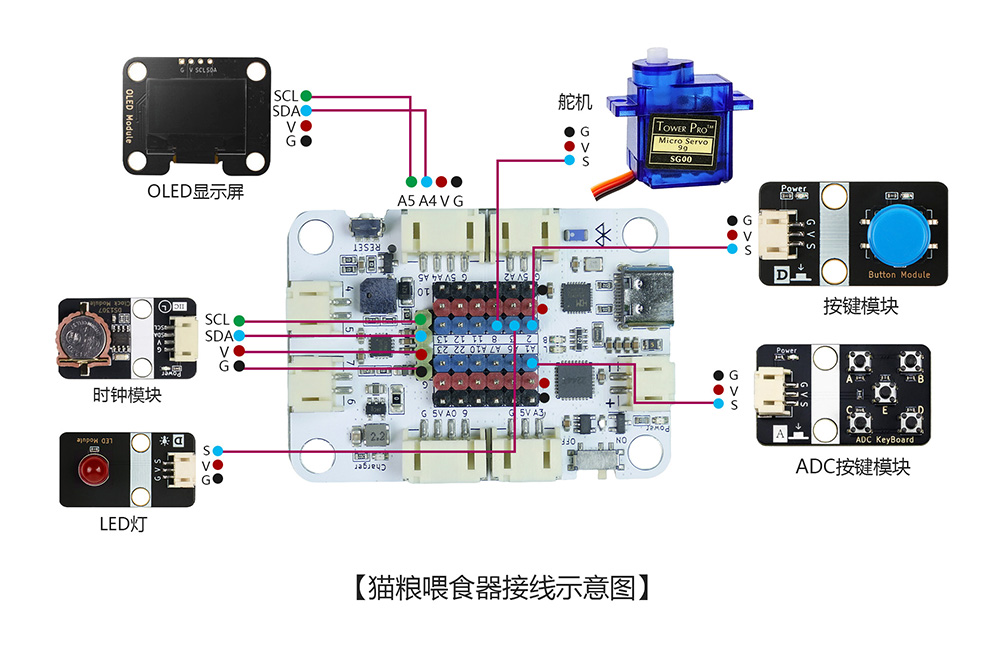
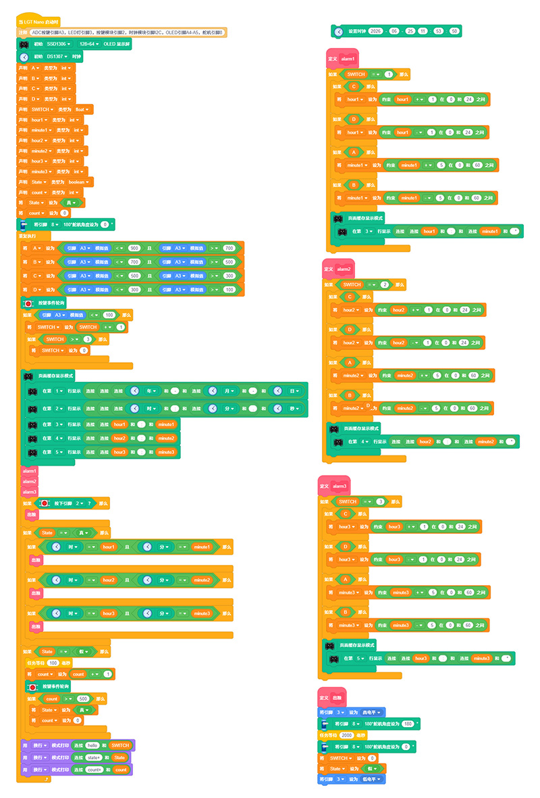

# 猫粮喂食器

## 产品概述

猫粮喂食器是一款由 LGT maker-nano 主板、DS1302 时钟模块、ADC 按键模块、按键模块、LED 指示灯、OLED 显示器、SG90 舵机组合而成的 STEM 手工拼装编程套件。套件可实现精准多时段自动投喂猫粮，支持自定义三组每日投喂时间，OLED 屏幕实时展示当前时间与三组预设投喂时段；到达设定时间后 SG90 舵机旋转开启出料口完成自动投食，同步 LED 指示灯常亮提示投喂状态；按下实体独立按键可手动触发单次投喂。通过制作该作品，能够学习实时时钟计时、多按键逻辑调节、OLED 图文显示、PWM 舵机角度控制、状态灯光指示等单片机控制知识，理解定时自动执行控制系统原理，培养宠物智能饲喂设备研发与嵌入式编程兴趣。
 

## 产品参数

| 参数 | 规格 |
|:----:|------|
| 型号 | zmf-0016 |
|   制作类型   | 手工拼装、采用螺丝紧固结构 |
| 使用环境 | -10℃ ~ +50℃ |
| 供电方式 | TYPE-C USB端口，供电电压5V |
| 产品尺寸 | 125x178x205mm |
| 核心主板 | LGT maker-nano 主板 |
| 硬件模组 | DS1302时钟模块、ADC按键模块、按键模块、LED指示灯、OLED显示器、SG90舵机 |
| 支持编程软件 | Blockcode（图形化编程+无线下载）、Mixly、Arduino |
| 结构材质 | 厚度2.5mm进口奥松板 |

 

## 功能特性

- 三组定时投喂设置
  - 通过 ADC 按键可自定义三组独立猫粮投喂时间，适配猫咪早、中、晚一日三次饲喂需求。
- 高精度实时时钟显示
  - DS1302 时钟模块持续精准计时，OLED 屏幕同步刷新展示设备当前系统时间与三组预设投喂时间，时间信息直观清晰。
- 手动一键临时投喂
  - 任意时段按下独立实体按键，可直接触发一次手动投喂，舵机动作、LED 同步点亮，满足临时加餐需求。
- 一键关闭提醒
  - 触发提醒后，按下独立按键模块可直接关闭本次语音与灯光提醒。
- 多功能 ADC 按键调节
  - E 键切换待设置时段；A、C 键调节小时数值增减；B、D 键调节分钟数值增减，操作简单易懂。
- 蓝牙无线程序下载
  - 主控板内置蓝牙通信，无需插拔数据线即可无线上传、调试、更换控制程序，程序修改便捷高效。

   

## 工作原理

设备上电后 DS1302 时钟模块持续独立计时，OLED 屏幕实时刷新展示当前系统时间与三组预设投喂时间。使用者通过 ADC 按键进入时间设置界面：E 键切换早、中、晚三组投喂时段，A/C 键调节小时，B/D 键调节分钟，修改完成后时间参数自动存储。

当设备实时时间与任意一组预设投喂时间完全匹配时，主板输出信号驱动 舵机旋转至出料角度，打开储粮仓下料通道完成自动投食，同步点亮 LED 状态指示灯；单次投喂流程结束后舵机自动回转复位闭合出料口，LED 指示灯熄灭，等待下一次定时触发。日常使用中按下独立实体按键，可跳过定时逻辑，直接执行一次手动投喂动作，舵机与 LED 同步工作。

 

## 使用说明

### 材料清单

| 名称              | 数量 | 名称            | 数量 | 名称                | 数量 |
| ----------------- | ---- | --------------- | ---- | ------------------- | ---- |
| LGT maker-nano    | 1    | DS1302 时钟模块   | 1    | 	MP3 语音模块 | 1    |
|OLED 显示器   | 1    | ADC 按键模块 | 1    | 按键模块  | 1    |
| 红色 LED 灯     | 3    | 椴木结构板  | 2    |   PH2.0转杜邦4pin线    | 1    |
| PH2.0转杜邦3pin线 | 5    | PH2.0双头4pin线 | 2    | 扎线带 | 3    |
| TYPEC-数据线      | 1    | 2pin-ph2.0单头   | 1    | 热缩管          | 3    |
| 塑料铆钉4070    | 24   | 塑料铆钉4120    | 3    | 2.3*6mm自攻螺丝     | 16  |
| 螺丝刀     | 1    |  

### 实物连接图

### 接线示意图

 

### 产品程序

[软件下载与安装](/docs/software/installation.md)

[Blockcode程序加载与上传](/docs/software/blockcode/Upload.md)

程序下载：
<a href="/docs/LGT-Nano系列/zmf-0003-智能提醒吃药/程序/0003-智能吃药提醒-blockcode.rar" download>0003-智能吃药提醒-blockcode</a>

音频下载：
<a href="/docs/LGT-Nano系列/zmf-0003-智能提醒吃药/0003-智能提醒吃药-音频.rar" download>0003-智能提醒吃药-音频</a>
 

### 初次使用操作步骤
1. 使用 TYPE-C 数据线将 LGT maker-nano 主板连接电脑，在 软件内打开「时钟校准程序」，在程序块内输入当前标准时间，上传程序完成系统时钟校准；

2. 软件端打开并上传「智能定时猫粮喂食器 - 主程序」，完成整机控制逻辑写入；
3. 操作 ADC 按键设置早、中、晚三组吃药提醒时间：
   * E 键：循环切换早、中、晚三个待设置时段；
   * A 键、C 键：对选中时段的小时数值进行加、减调节；
   * B 键、D 键：对选中时段的分钟数值进行加、减调节；
4. 时间设置完成后参数自动保存，OLED 屏幕持续显示当前实时时间与三组预设投喂时间；
5. 自动投喂：到达预设投喂时间，SG90 舵机旋转出料，LED 指示灯同步点亮，投喂完成舵机自动复位、灯光熄灭；
6. 手动投喂：任意时刻按下独立实体按键，立即执行单次手动投喂，舵机下料、LED 同步亮起，投喂结束自动复位。

### 安全与使用注意事项
1. 仅适配干燥颗粒猫粮，禁止放入湿粮、罐头、结块粮食，避免堵塞舵机出料结构；
2. 电子控制模块不可沾水清洁，接粮碗可自配易清洗的容器；
3. 本产品为diy拼装作品，适合做教学和科技展示。不宜作为生活用品长时间使用。长时间不使用请断开 TYPE-C 供电；

### 组装教程

组装视频教程请移步公众号，扫码关注一下

