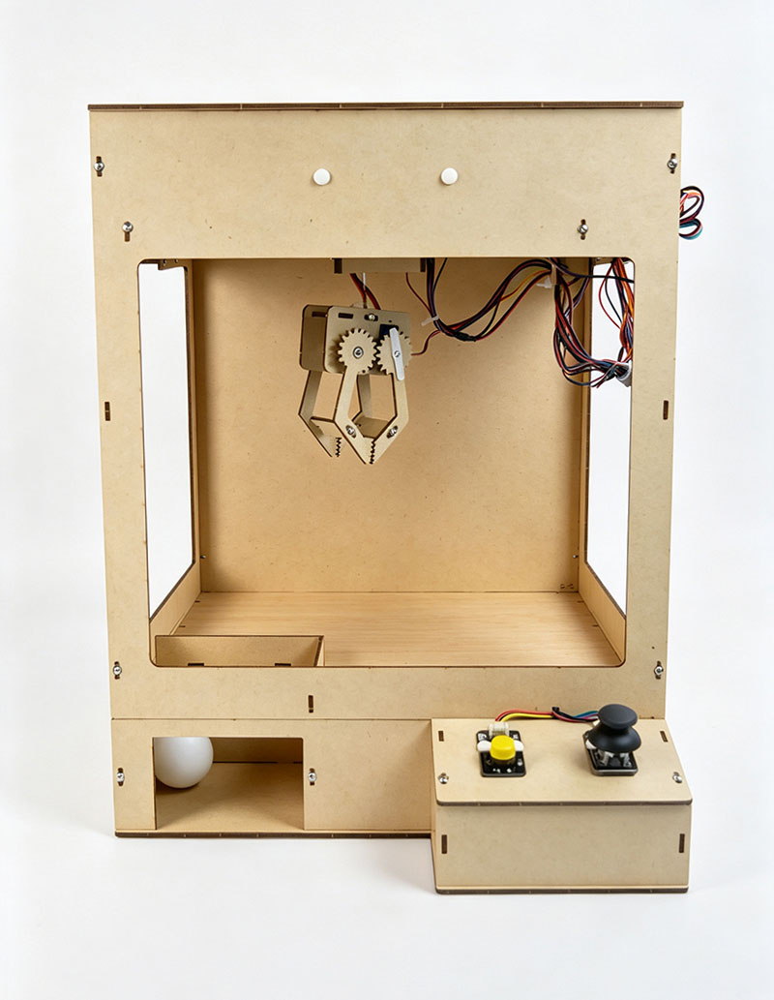
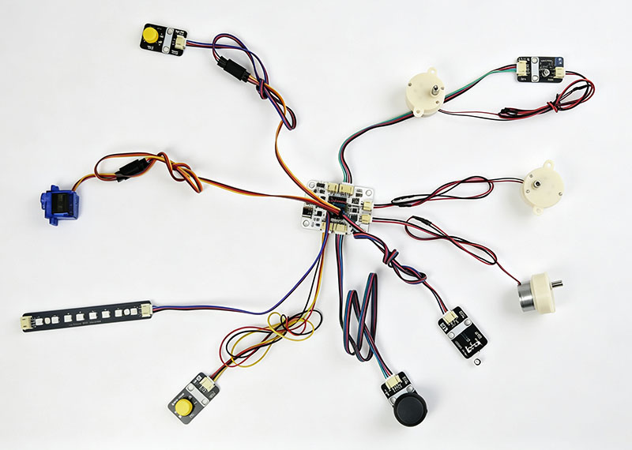
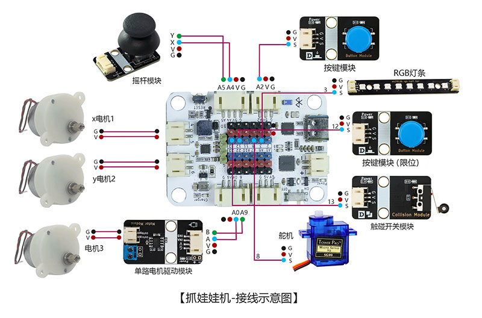
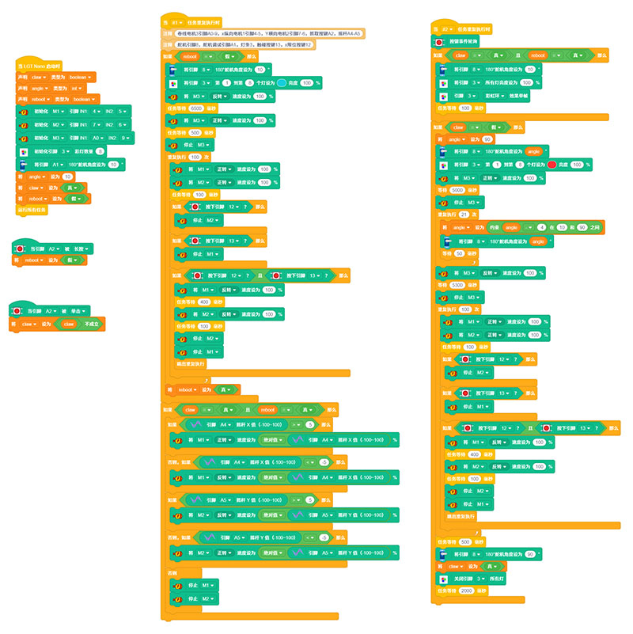

# 抓娃娃机

## 产品概述

抓娃娃机是一款由 LGT-Maker-Nano 主板、摇杆模块、触碰开关模块、按键模块、RGB 灯条、单路电机驱动模块、SG90 舵机、JS30 驱动电机组合而成的 STEM 手工拼装编程套件。套件具备复位与工作双运行模式，支持摇杆双轴控制抓取机构移动、一键自动抓取娃娃，RGB 灯条同步显示设备运行状态，触碰开关实现硬件限位保护。通过制作该作品，能够学习双轴电机驱动、舵机抓取控制、摇杆模拟量输入、触碰限位检测、RGB 灯条状态指示、自动流程逻辑编程等单片机控制知识，理解智能抓取执行系统原理，培养游艺智能设备研发与嵌入式编程兴趣。

 

## 产品参数

|参数|规格|
|---|---|
|型号|zmf-0018|
|制作类型|手工拼装、采用螺丝紧固结构|
|使用环境|-10℃ ~ +50℃|
|供电方式|Type-C   USB 端口，供电电压 5V|
|产品尺寸|300x364x390mm|
|核心主板|LGT-Maker-Nano 主板|
|硬件模组|摇杆模块、触碰开关模块、按键模块、RGB灯条、单路电机驱动模块、SG90 舵机、JS30 驱动电机|
|支持编程软件|BlockCode (图形化编程 + 无线下载)、Mixly、Arduino|
|结构材质|厚度 2.5mm 进口奥松板|

 

## 功能特性

- 双模式自动切换
  - 设备内置复位、工作两种运行模式，上电自动进入复位模式完成机构归零，复位完成后自动跳转工作模式；也可通过长按按键手动触发复位，模式切换逻辑清晰。
- 摇杆双轴精准控制
  - 工作模式下通过摇杆模块可分别控制 X 轴、Y轴 JS30 电机运转，带动抓取机构平面移动，操作手感流畅，可精准定位至目标娃娃上方位置。
- 一键自动抓取投放
  - 按下抓取按键即可触发自动抓取流程，自动完成爪子下降、张开、闭合抓娃、上升、复位移动、张开投放全流程，无需分步手动操作。
- RGB 灯条状态指示
  - RGB 灯条对应不同模式显示不同灯光效果：复位模式亮蓝色常亮，工作模式显示彩虹流动效果，自动抓取过程亮红色常亮，设备状态直观可见。
- 触碰限位安全保护
  - X 轴、Y 轴均配置触碰开关模块，机构移动至边界时触发限位，电机自动停止运转并小幅回转，避免机构硬撞击损坏硬件。
- 长按一键复位
  - 工作模式下长按抓取按键，设备立即进入复位模式，所有电机与舵机自动回归初始位置，复位完成后自动回到工作模式待命。 
- 支持无线下载：直接通过蓝牙下载程序，方便调试和更换控制代码。

   

## 工作原理

- 设备上电后自动进入复位模式，RGB 灯条显示蓝色常亮，SG90 舵机带动爪子复位至闭合状态，X 轴、Y 轴 JS30 电机分别向起点位置移动；当电机触发对应方向触碰开关时，该轴电机停止运转，待所有轴均到达初始位置后，电机整体小幅回转后停止，设备自动切换至工作模式。
- 工作模式下RGB 灯条显示彩虹流动效果，摇杆模块输出 X、Y 双轴模拟量信号至主控板，主控根据摇杆偏移方向与幅度控制对应 JS30 电机转速与转向，带动抓取机构左右、前后移动，可将爪子定位至目标娃娃上方。
- 工作模式下短按抓取按键，设备进入自动抓取模式，RGB 灯条切换为红色常亮；主控驱动电机带动爪子下降，同时 SG90 舵机控制爪子张开；爪子靠近底部后舵机反向转动闭合爪子抓起娃娃，随后电机回转带动爪子上升；上升到位后 X、Y 轴电机同步运转，将抓取机构移动至初始落物点上方，舵机控制爪子张开，娃娃落至取物口，完成单次抓取任务，设备自动回到工作模式。
- 工作模式下长按抓取按键，设备强制进入复位模式，所有执行机构完成归零复位后，自动跳转回工作模式。整套装置集双轴传动、舵机执行、摇杆控制、限位检测、灯光状态反馈于一体，完整演示智能抓取类游艺设备的闭环控制逻辑。

 

## 使用说明

### 材料清单

|名称|数量|名称|数量|名称|数量|
|---|---|---|---|---|---|
|LGT-Maker-Nano 主板|1|摇杆模块|1|触碰开关模块|1|
|按键模块|2|RGB 灯条|1|单路电机驱动模块|1|
|SG90 舵机|1|JS30 电机|3|奥松结构板|10|
|舵机延长线|2|PH2.0 转杜邦 3pin 线|3|PH2.0双头 3pin 线|1|
|PH2.0 双头 4pin 线|1|2pin-PH2.0 单头线|3|Type-C   数据线|1|
|红黑硅胶并线|1|零件包|1|||

### 实物连接图

### 接线示意图

 

### 产品程序

[软件下载与安装](/docs/software/installation.md)

[BlockCode程序加载与上传](/docs/software/blockcode/Upload.md)

程序下载：

<a href="/docs/LGT-Nano系列/zmf-0018-抓娃娃机/程序/0018-抓娃娃机-blockcode.rar" download>zmf-0018-抓娃娃机-blockcode</a>

 

### 组装教程

组装视频教程请移步公众号，扫码关注一下

 
下载相关内容请进入文档中心：

[文档中心](https://shanyuknowledge.github.io/#/)