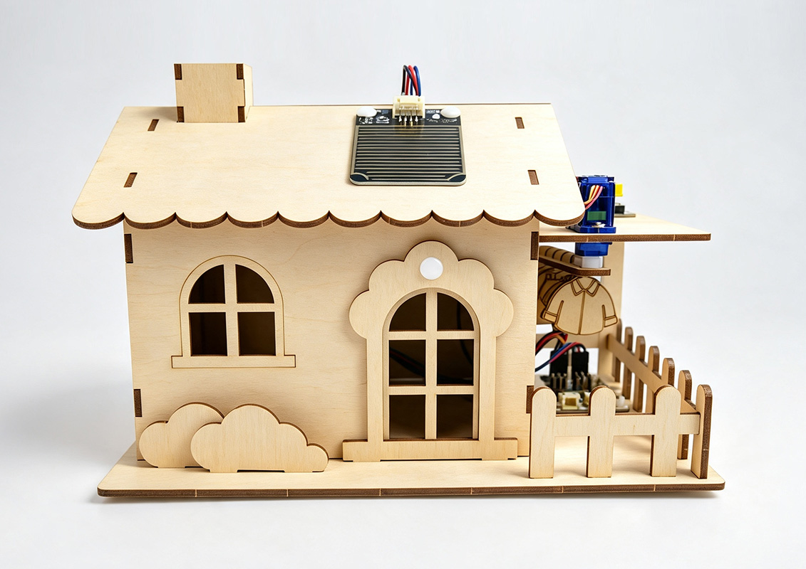
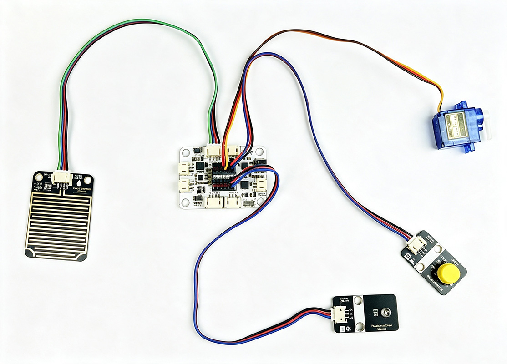
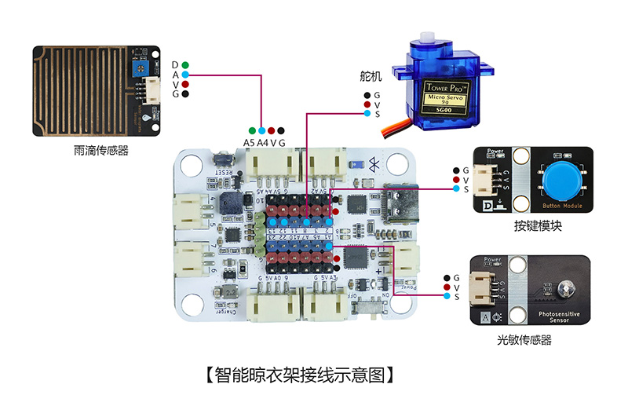
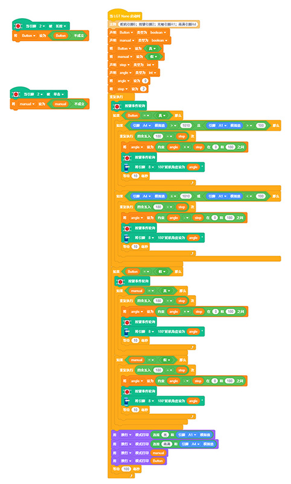

# 智能晾衣架

## 产品概述

智能晾衣架是一款由 LGT maker-nano 主板、SG90 舵机、光敏传感器、雨滴传感器、按键模块等配件组合而成的 STEM 手工拼装编程套件。此套件可实现功能：雨滴传感器检测雨水、光敏传感器检测天黑时，自动驱动舵机收回晾衣架；支持手动 / 自动双模式切换，手动模式下按键控制晾衣架展开晾晒与收回；通过制作这个作品，让孩子掌握雨水、光照环境检测、舵机角度控制、模式切换逻辑等知识，了解家居自动化感应控制原理，提升科学探究兴趣。

 

## 产品参数

| 参数 | 规格 |
|:----:|------|
| 型号 | zmf-0019 |
|   制作类型   | 手工拼装、采用螺丝紧固结构    |
| 使用环境 | -10℃ ~ +50℃ |
| 供电方式 | TYPE-CUSB端口，供电电压5V |
| 产品尺寸 | 215x164x145mm |
| 核心主板 | LGT maker-nano 主板 |
| 硬件模组 | SG90 舵机、光敏传感器、雨滴传感器、按键模块 |
| 支持编程软件 | Blockcode（图形化编程+无线下载）、Mixly、Arduino |
| 结构材质 | 厚度2.5mm进口奥松板 |

 

## 功能特性

- 下雨自动收衣服

- 天黑自动收衣服

- 手动和自动双工作模式切换

- 支持无线下载：直接通过蓝牙下载程序，方便调试和更换代码

   

## 工作原理

设备上电后默认进入自动模式，雨滴传感器与光敏传感器持续采集环境信号并传输至 LGT maker-nano 主控板。当传感器检测到下雨或者环境光照不足时，主控板输出信号控制 SG90 舵机转动，带动晾衣架自动收回；长按按键即可切换至手动模式，此时环境感应功能失效，每短按一次按键，舵机切换晾衣架展开、收回状态。再次长按按键切回自动模式，设备恢复雨水、光照自动感应收衣功能，完整演示家居环境感应自动控制流程，自动化演示效果直观清晰。

 

## 使用说明

### 材料清单

| 名称              | 数量 | 名称            | 数量 | 名称                | 数量 |
| ----------------- | ---- | --------------- | ---- | ------------------- | ---- |
| LGT maker-nano    | 1    | sg90舵机        | 1    | 雨滴传感器 | 1    |
| 按键模块    | 1    | 光敏传感器  | 1    | PH2.0 双头 4pin 线   | 1    |
| PH2.0转杜邦3pin线   | 2    |  TYPEC-数据线 | 1    | 椴木结构板  | 3    |
| 塑料铆钉4070      | 12   |   螺丝刀     | 1    | 2.3*6mm自攻螺丝     | 10   |

### 实物连接图

### 接线示意图

 

### 产品程序

[软件下载与安装](docs/software/installation.md)

[Blockcode程序加载与上传](docs/software/blockcode/Upload.md)

程序下载：

<a href="docs/LGT-Nano系列/zmf-0019-智能晾衣架/程序/0019-智能晾衣架-blockcode.rar" download>0019-智能晾衣架-blockcode</a>

 

### 组装教程

组装视频教程请移步公众号，扫码关注一下

