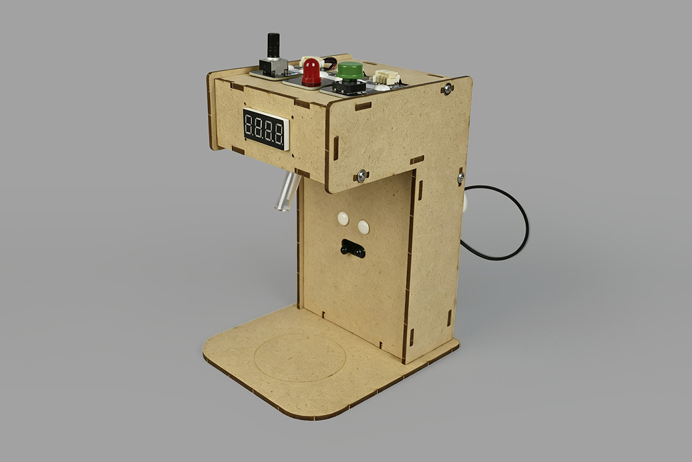
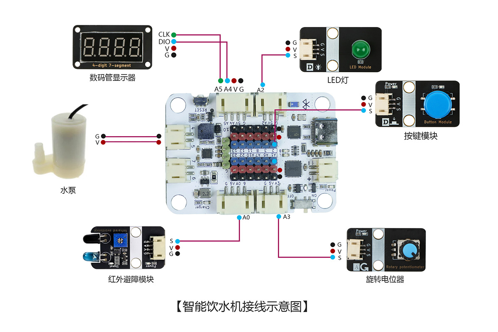
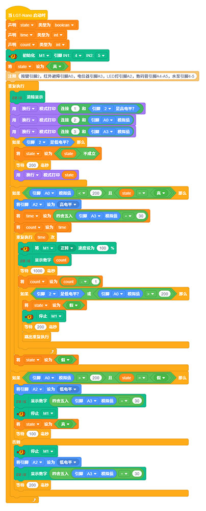

# 智能饮水机

## 产品概述

智能饮水机是一款由 LGT-Maker-Nano 主板、水泵、1650 四位数码管、旋转电位器、按键模块、红外避障模块等配件组合而成的 STEM 编程拼装套件。此套件可实现功能：红外感应水杯自动出水，旋转电位器自定义定量出水时长；四位数码管实时显示设定出水时间；工作状态 LED 灯光提示；按键支持紧急停水与长按手动出水；通过制作该作品，让孩子掌握红外感应检测、模拟量调节、数码管显示、水泵驱动等单片机控制知识，理解自动感应控水逻辑，提升电子电路与自动化编程探究兴趣。

 

## 产品参数

| 参数 | 规格 |
|:----:|------|
| 型号 | zmf-0021 |
|   制作类型   | 手工拼装、采用螺丝紧固结构 |
| 使用环境 | -10℃ ~ +50℃ |
| 供电方式 | Type-C    USB端口，供电电压5V |
| 产品尺寸 | 118x100x152mm |
| 核心主板 | LGT-Maker-Nano 主板 |
| 硬件模组 | 微型水泵、1650 四位数码管、旋转电位器、按键模块、红外避障模块、LED 灯 |
| 支持编程软件 | BlockCode（图形化编程+无线下载）、Mixly、Arduino |
| 结构材质 | 厚度2.5mm进口奥松板 |

 

## 功能特性

- 水杯红外感应防误出水
  - 红外避障模块实时检测接水区，无水杯放置时水泵锁定不启动，防止空抽、漏水浪费；水杯到位后自动解锁定量出水功能。
- 电位器自定义出水时长
  - 旋转电位器调节单次定量出水时间，时长数值同步在数码管实时刷新，自由设置取水时长。
- 四位数码管数值显示
  - 1650 四位数码管静态展示当前设定出水秒数，数值清晰直观，方便观察调节参数。
- 双模式按键控制
  - 短按按键：紧急切断水泵，立刻停止出水；长按按键：忽略红外感应，强制手动持续出水，适配特殊取水场景。
- 工作状态灯光指示
  - 水泵启动出水时 LED 指示灯常亮；待机 / 停水状态下 LED 熄灭，直观区分设备工作状态。
- 支持无线下载：直接通过蓝牙下载程序，方便调试和更换控制代码。

   

## 工作原理

设备上电初始化完成后，红外避障模块持续扫描出水口下方接水区域，同时旋转电位器实时向主控板传输模拟量信号，转换为对应出水时长数值并推送至 1650 四位数码管实时显示。

1. 自动定量模式：检测到水杯遮挡红外感应区，主控驱动水泵按设定时长出水，同步点亮工作 LED；计时结束自动关停水泵、熄灭 LED；若中途移走水杯，水泵立即停止。
2. 紧急停止功能：出水过程中短按实体按键，直接切断水泵输出，强制终止出水。
3. 手动强制出水：长按按键，系统跳过红外水杯检测逻辑，水泵持续供水，松开按键即停止。

整套装置实现感应检测、参数调节、数字显示、灯光提示、水泵执行、应急停止一体化自动控水演示，自动化控制逻辑清晰易懂。

 

## 使用说明

### 材料清单

| 名称         | 数量 | 名称       | 数量 | 名称         | 数量 |
| -------- | ---- | --------- | ---- | ----------- | ---- |
| LGT-Maker-Nano    | 1    | 微型水泵        | 1    | 30cm软管 | 1    |
| 1650四位数码管   | 1    | 旋转电位器  | 1    | 按键模块  | 1    |
| 红外避障模块     | 1    | 椴木结构板  | 2    | 2pin-PH2.0单头      | 1    |
| PH2.0转杜邦3pin线 | 1    | PH2.0双头4pin线 | 2    | PH2.0双头3pin线  | 2    |
| Type-C  数据线      | 1    | 螺丝刀  | 1    | 热缩管          | 3    |
| 塑料铆钉4070      | 12   | 塑料铆钉4120    | 3    | 2.3*6mm自攻螺丝     | 12   |

### 实物连接图

### 接线示意图

 

### 产品程序

[软件下载与安装](docs/software/installation.md)

[BlockCode程序加载与上传](docs/software/blockcode/Upload.md)

程序下载：

<a href="docs/LGT-Nano系列/zmf-0021-智能饮水机/程序/0021-智能饮水机-blockcode.rar" download>zmf-0021-智能饮水机-blockcode</a>

 

### 组装教程

组装视频教程请移步公众号，扫码关注一下

 
下载相关内容请进入文档中心：

[文档中心](https://shanyuknowledge.github.io/#/)
