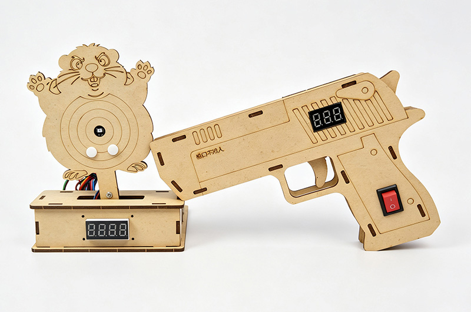
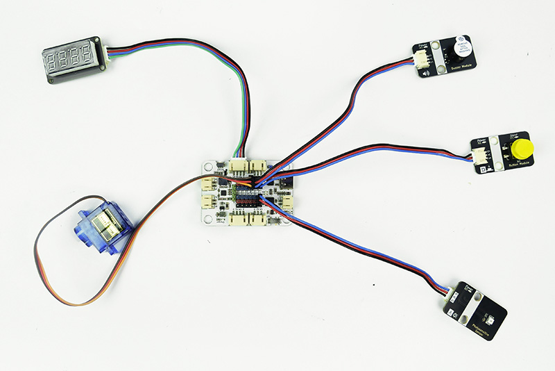
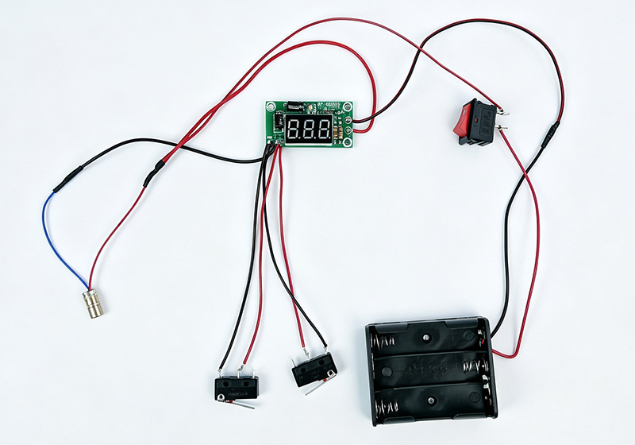
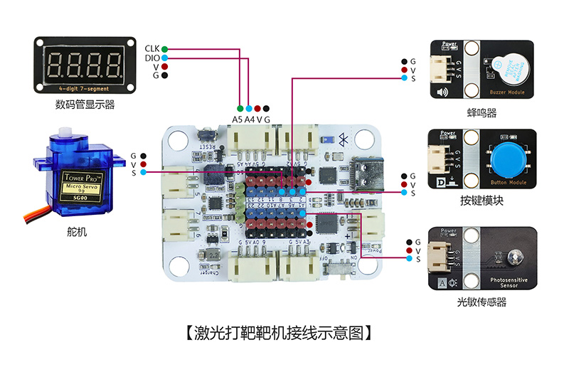
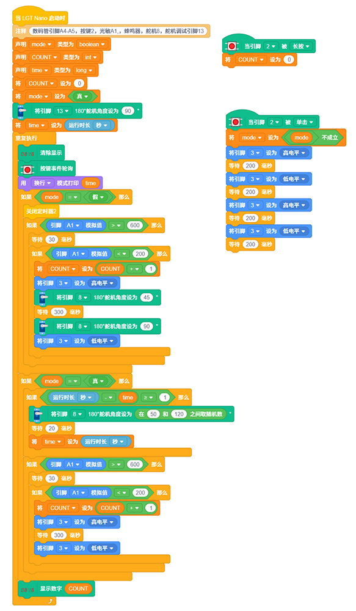

# 0025-激光打靶

## 产品概述

激光打靶是一款由靶机主机与激光手枪两部分组成的 STEM 手工拼装编程套件，核心硬件包含 LGT-Maker-Nano 主板、光敏传感器、1650 四位数码管、按键模块、蜂鸣器、SG90 舵机、计数模块、微动开关、船型开关、激光发射器。套件支持随机、简单两种打靶模式，可实现激光命中自动计数、实时显示、声光同步命中反馈；舵机带动靶子动态摆动，配合手枪独立发射计数，还原真实射击交互体验。通过制作该作品，能够学习光电传感检测、舵机角度控制、计数逻辑编程、双端人机交互、显示驱动、声光反馈控制等单片机控制知识，理解光电感应互动系统原理，培养智能互动装置研发与嵌入式编程兴趣。

 

## 产品参数

|参数|规格|
|---|---|
|型号|zmf-0025|
|制作类型|手工拼装、采用螺丝紧固结构|
|使用环境|-10℃ ~ +50℃|
|供电方式|靶机端：Type-C   USB 端口，供电电压 5V；手枪端：直流电池供电|
|产品尺寸|靶机：115x110x150mm；激光手枪：194x127x23mm|
|核心主板|LGT-Maker-Nano 主板（靶机端）|
|硬件模组|光敏传感器、1650 四位数码管、按键模块、蜂鸣器、OLED 显示器、SG90 舵机、计数模块、微动开关、船型开关、激光发射器|
|支持编程软件|BlockCode (图形化编程 + 无线下载)、Mixly、Arduino|
|结构材质|厚度 2.5mm 进口奥松板|

 

## 功能特性

- 双模式靶机切换
  - 靶机内置随机、简单两种打靶模式，上电默认进入随机模式，舵机带动靶子随机角度摆动，提升打靶难度；短按按键切换简单模式，靶子在两个固定角度间循环切换，适配入门练习使用。
- 精准光电命中检测
  - 靶子中心搭载高灵敏度光敏传感器，可快速精准识别激光手枪发射的激光信号，命中判定响应及时、准确率高，稳定支持动态、静态两种打靶场景。
- 双端计数实时显示
  - 靶机端 OLED 显示器实时显示累计命中总次数，手枪端 1650 四位数码管同步显示发射次数，射击数据一目了然，便于统计命中率。
- 声光同步命中反馈
  - 成功命中靶心时，靶机端蜂鸣器同步发出提示音，显示器实时统计数值，配合计数数值跳变，射击反馈感强，提升互动体验与趣味性。
- 手枪独立计数控制
  - 激光手枪内置计数模块与微动开关扳机，扣动一次扳机同步完成发射计数累加与激光发射；配备保险按键，向下长按可一键清零手枪端发射次数。
- 一键操作逻辑清晰
  - 靶机端短按按键切换打靶模式，长按按键一键清零命中计数；操作逻辑简单直观，无需复杂学习即可快速上手。
- 支持无线下载：直接通过蓝牙下载程序，方便调试和更换控制代码。

   

## 工作原理

- 靶机端上电后系统初始化，默认进入随机模式，LGT-Maker-Nano 主板输出 PWM 信号控制 SG90 舵机持续随机角度摆动，带动搭载光敏传感器的靶子同步转动，OLED 显示器显示初始命中次数 0。当光敏传感器检测到激光信号时，触发命中逻辑，命中计数加 1，OLED 同步更新显示数值，同时蜂鸣器发出提示音。
- 短按靶机按键，系统切换为简单模式，舵机带动靶子停在第一固定角度；当光敏传感器检测到激光信号时，触发命中逻辑，命中计数加 1，OLED 同步更新显示数值，同时蜂鸣器发出提示音；随后舵机转动至第二固定角度，短暂停留后自动返回第一固定角度，等待下一次命中。
- 长按靶机按键，系统清空命中计数，OLED 显示归零，保持当前运行模式不变。
- 激光手枪装入电池后，拨动船型开关开机，计数模块四位数码管显示上一次发射次数；向下长按保险按键，手枪端计数清零，数码管显示归零；扣动扳机触发微动开关，计数模块累加一次发射计数，同步驱动激光发射器发射一束激光脉冲。
- 整套装置集光电传感、舵机控制、双端计数、显示交互、声光反馈于一体，完整演示光电感应互动类智能设备的控制逻辑。
 

## 使用说明

### 材料清单

|名称|数量|名称|数量|名称|数量|
|---|---|---|---|---|---|
|LGT-Maker-Nano 主板|1|光敏传感器|1|SG90 舵机|1|
|激光发射器|1|1650 四位数码管|1|按键模块|1|
|蜂鸣器|1|计数模块|1|微动开关|2|
|船型开关|1|3节电池盒|1|奥松结构板|2|
|红黑线|1|PH2.0 转杜邦 3pin 线|3|PH2.0双头同向 4pin 线|1|
|Type-C   数据线|1|零件包|1|||

### 实物连接图
- 激光打靶靶机-实物连接图

- 激光打靶激光枪-实物连接图

### 接线示意图

 

### 产品程序

[软件下载与安装](/docs/software/installation.md)

[BlockCode程序加载与上传](/docs/software/blockcode/Upload.md)

程序下载：

<a href="/docs/LGT-Nano系列/zmf-0025-激光打靶/程序/0025-激光打靶-blockcode.rar" download>zmf-0025-激光打靶-blockcode</a>

 

### 组装教程

组装视频教程请移步公众号，扫码关注一下

 
下载相关内容请进入文档中心：

[文档中心](https://shanyuknowledge.github.io/#/)