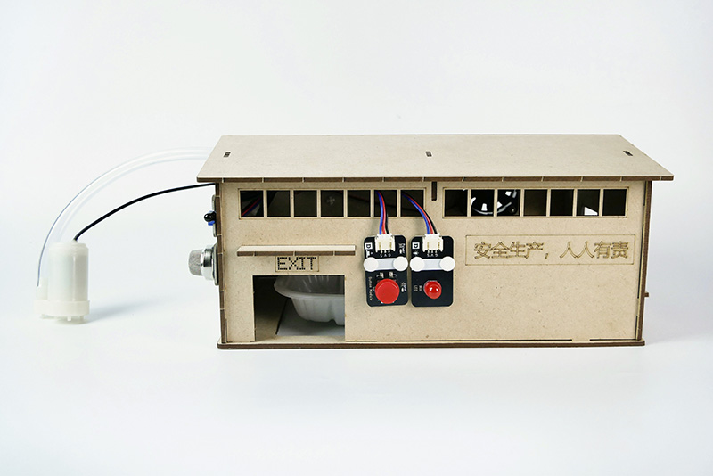
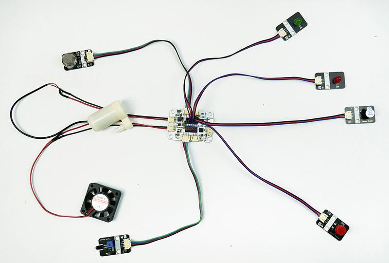
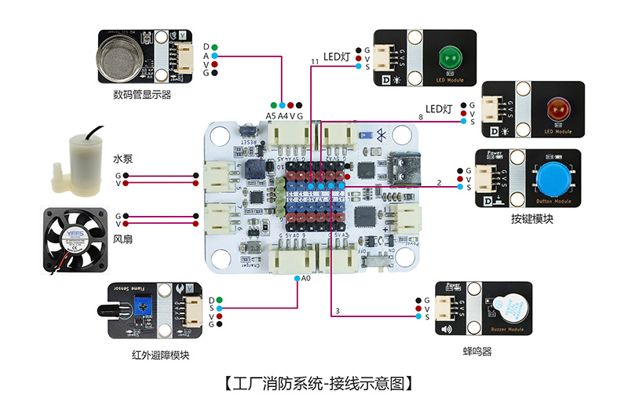
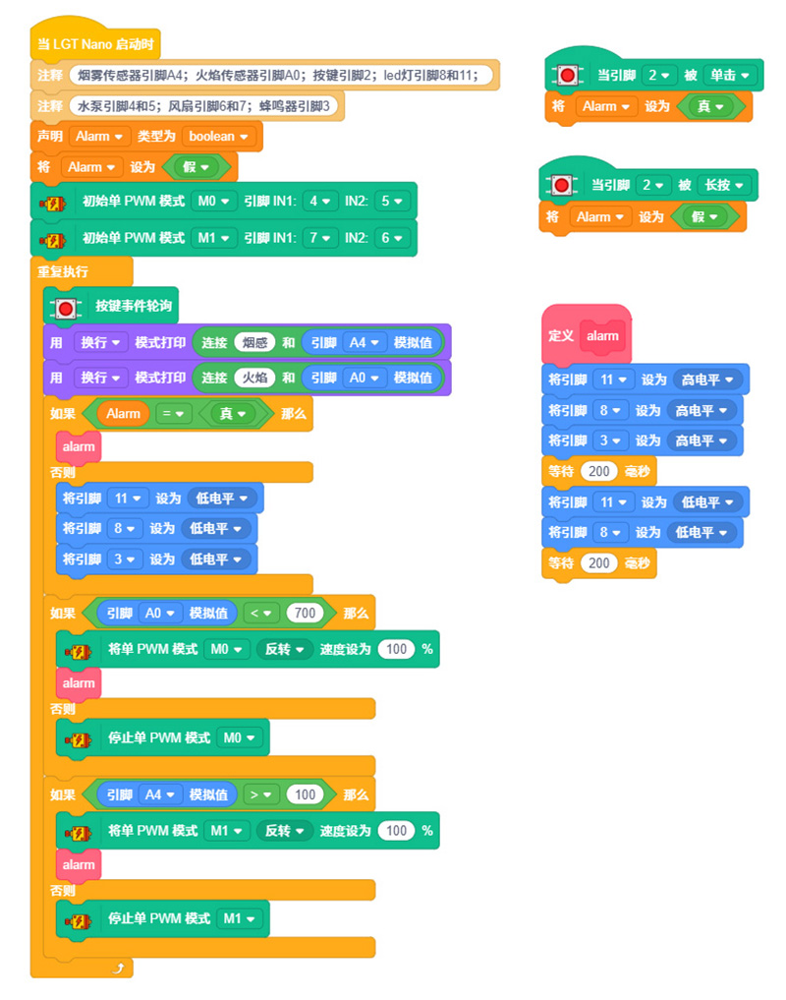

# 工厂消防系统

## 产品概述

工厂消防系统是一款由 LGT maker-nano 主板、立式水泵、火焰传感器、MQ-4气体传感器、LED灯、有源蜂鸣器、散热风扇等模块组合而成的 STEM 编程拼装套件。此套件可实现功能：火焰传感器检测明火自动声光报警、点亮逃生指示灯并启动水泵喷水灭火；MQ-4 气体传感器检测燃气、烟雾后触发报警，开启风扇排风；支持手动一键报警；通过制作这个作品，让孩子了解火灾、可燃气体检测原理，掌握消防报警、灭火、排烟联动控制逻辑，学习工业安防基础知识，提升科学探究兴趣。

 

## 产品参数

| 参数 | 规格 |
|:----:|------|
| 型号 | zmf-0026 |
|   制作类型   | 手工拼装、采用螺丝紧固结构 |
| 使用环境 | -10℃ ~ +50℃ |
| 供电方式 | TYPE-C USB端口，供电电压5V |
| 产品尺寸 | 256x167x110mm |
| 核心主板 | LGT maker-nano 主板 |
| 硬件模组 | 立式水泵、火焰传感器、MQ-4气体传感器、LED灯、有源蜂鸣器、散热风扇、按键等模块 |
| 支持编程软件 | Blockcode（图形化编程+无线下载）、Mixly、Arduino |
| 结构材质 | 厚度2.5mm进口奥松板 |

 

## 功能特性

- 明火消防联动处理
  - 火焰传感器检测到明火信号，有源蜂鸣器持续鸣笛报警，红色故障警示LED点亮、绿色通道指示灯同步亮起，主控驱动水泵运转，通过软管喷水模拟现场灭火。
- 燃气/烟雾排风报警
  - 气体传感器识别到可燃气体、烟雾浓度超标时，蜂鸣器发出警报，红色LED、绿色通道灯同时点亮，自动启动散热风扇模拟厂房排烟通风。
- 手动一键报警功能
  - 按下报警按键可手动触发消防报警状态，红色警示LED、绿色逃生通道灯点亮，蜂鸣器发出警报提示险情。确定险情结束，长按按键解除报警
- 状态灯光区分
  - 红色LED代表险情警示，绿色LED代表安全疏散通道指引，两种灯光同步亮起提醒人员撤离。
- 支持无线下载：直接通过蓝牙下载程序，方便调试和更换控制代码。

   

## 工作原理

设备上电后主板持续采集火焰传感器、MQ-4 气体传感器实时数据，循环检测环境安全状态。

1. 明火检测流程：火焰传感器捕捉明火信号并传输至主控，主板立即输出信号驱动有源蜂鸣器鸣响，红色警示 LED、绿色通道 LED 同时点亮，同步启动立式水泵喷水灭火；
2. 燃气烟雾检测流程：MQ-4 检测到超标燃气或烟雾，触发蜂鸣器报警，红、绿 LED 双灯点亮，启动散热风扇进行排风；
3. 手动报警流程：按下实体报警按键，系统强制进入报警模式，蜂鸣器工作，红色、绿色 LED 同步点亮，模拟人工上报火情。
整套装置完整模拟工厂火情检测、声光报警、灭火、排烟、手动报警一体化消防联动流程，自动化演示效果直观清晰。

 

## 使用说明

### 材料清单

| 名称              | 数量 | 名称            | 数量 | 名称                | 数量 |
| ----------------- | ---- | --------------- | ---- | ------------------- | ---- |
| LGT maker-nano    | 1    | 立式水泵        | 1    | 40cm软管 | 1    |
| MQ-4气体传感器   | 1    | 散热风扇  | 1    | 按键模块  | 1    |
|  绿色LED灯  | 1    | 红色LED灯 | 1    | 有源蜂鸣器  | 1    |
| 火焰传感器  | 1    | 椴木结构板  | 4    | 2pin-ph2.0单头      | 2    |
| PH2.0转杜邦3pin线 | 1    | PH2.0双头4pin线 | 2    | PH2.0双头3pin线  | 2    |
| TYPEC-数据线      | 1    | 零件包  | 1    | 

### 实物连接图

### 接线示意图

 

### 产品程序

[软件下载与安装](docs/software/installation.md)

[Blockcode程序加载与上传](docs/software/blockcode/Upload.md)

程序下载：

<a href="docs/LGT-Nano系列/zmf-0026-工厂消防系统/程序/0026-工厂消防系统-blockcode.rar" download>0026-工厂消防系统-blockcode</a>

 

### 组装教程

组装视频教程请移步公众号，扫码关注一下

