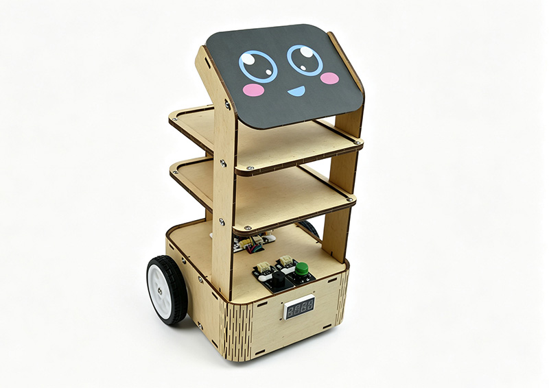
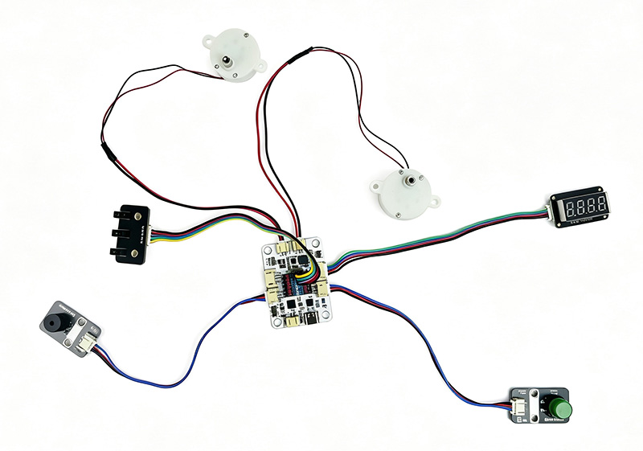
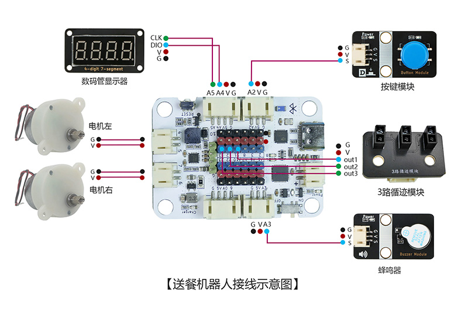
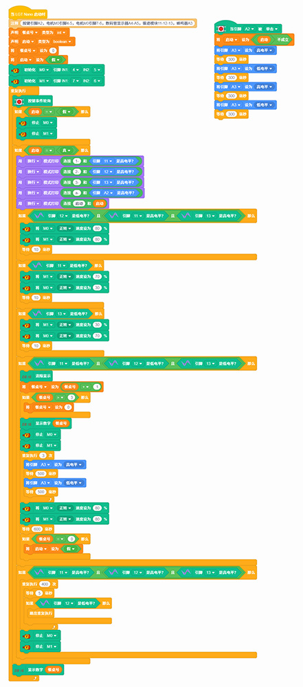

# 送餐机器人

## 产品概述

送餐机器人是一款由 LGT-Maker-Nano 主板、1650 四位数码管、按键模块、三路红外循迹模块、有源蜂鸣器模块、JS30电机等组合而成的 STEM 手工拼装编程套件。套件可实现自动沿轨巡线送餐，支持十字路标识别与餐号自动计数，数码管实时显示当前送餐序号；到达站点路标时自动停靠数秒后继续行驶，累计完成 4 站配送后自动停止任务。通过制作该作品，能够学习红外循迹传感、电机驱动控制、数码管静态显示、计数逻辑编程、蜂鸣器状态提示等单片机控制知识，理解自动导航执行系统原理，培养智能物流设备研发与嵌入式编程兴趣。

 

## 产品参数

| 参数 | 规格 |
|:----:|------|
| 型号 | zmf-0034 |
|   制作类型   | 手工拼装、采用螺丝紧固结构 |
| 使用环境 | -10℃ ~ +50℃ |
| 供电方式 | Type-C    USB端口，供电电压5V |
| 产品尺寸 | 175x145x180mm |
| 核心主板 | LGT-Maker-Nano 主板 |
| 硬件模组 | 1650 四位数码管、按键模块、三路红外循迹模块、有源蜂鸣器模块、JS30 电机 |
| 支持编程软件 | BlockCode（图形化编程+无线下载）、Mixly、Arduino |
| 结构材质 | 厚度2.5mm进口奥松板 |

 

## 功能特性

- 自动红外循迹行驶
  - 搭载三路红外循迹模块，可自动识别地面黑色线路，实时修正行驶方向，沿预设轨道稳定行驶，适配浅色平面场地使用。
- 十字路标自动计数
  - 每隔固定距离设置的十字横向路标可被传感器精准识别，每经过一个路标餐号自动加 1，1650 四位数码管实时显示当前送餐序号，配送进度直观可见。
- 站点自动启停控制
  - 识别到十字站点路标后，餐车自动停靠数秒，完成站点配送后自动继续行驶；累计送达 4 个站点后，餐车自动停止运行，完成整轮送餐任务。
- 一键启动任务
  - 按下实体启动按键即可触发送餐任务，全程自动运行无需人工干预，操作简单便捷。
- 蜂鸣器状态提示
  - 设备启动、站点停靠、任务完成等不同状态均对应不同蜂鸣器提示音，无需观察屏幕即可掌握设备运行状态。
- 支持无线下载：直接通过蓝牙下载程序，方便调试和更换控制代码。

   

## 工作原理

- 设备上电后系统初始化，1650 四位数码管显示初始餐号 0，三路红外循迹模块处于待机检测状态。按下启动按键后，蜂鸣器短响提示，主板输出信号驱动 JS30 电机运转，餐车开始沿预设黑色胶布轨道行驶。
- 行驶过程中，三路红外传感器实时采集地面反射信号，传输至主控板进行路线偏差判断，动态调整左右电机转速，保持餐车沿黑色轨道行驶。当传感器识别到横向十字路标时，主控触发计数逻辑，餐号数值加 1 并更新数码管显示，同时电机停转、蜂鸣器提示停靠；停靠数秒后，电机重新启动，餐车继续沿轨道行驶。
- 当餐号计数累计至 4 时，主控板停止电机输出，餐车驻车，蜂鸣器长鸣提示任务完成，整套送餐流程结束。整套装置集红外传感、电机驱动、计数显示、状态提示于一体，完整演示自动循迹执行类智能设备控制逻辑。

 

## 使用说明

### 材料清单

|名称|数量|名称|数量|名称|数量|
|---|---|---|---|---|---|
|LGT-Maker-Nano 主板|1|1650 四位数码管|1|三路红外循迹模块|1|
|有源蜂鸣器模块|1|JS30 驱动电机|2|按键模块|1|
|奥松结构板|3|PH2.0 转杜邦 5pin 线|1|PH2.0双头同向 3pin 线|2|
|PH2.0 双头 4pin 线|1|2pin-PH2.0 单头线|2|Type-C    数据线|1|
|轮子|2|万向轮|2|电工胶布|1|
|表情贴纸|1|零件包|1||

### 实物连接图

  
### 接线示意图

 

### 产品程序

[软件下载与安装](/docs/software/installation.md)

[BlockCode程序加载与上传](/docs/software/blockcode/Upload.md)

程序下载：

<a href="/docs/LGT-Nano系列/zmf-0034-送餐机器人/程序/0034-送餐机器人-blockcode.rar" download>zmf-0034-送餐机器人-blockcode</a>

 

### 初次使用操作步骤

1. 场地布置：使用黑色电工胶布在白色或浅色平整地板上粘贴出送餐行驶主线路，每隔约 30 厘米粘贴一段横向电工胶布，形成十字路标，共设置 4 个站点路标；

2. 设备放置：打开餐车电源开关，将餐车居中放置在巡线轨道起点位置，确保三路红外传感器正对下方黑色轨道线；

3. 启动任务：按下启动按键，蜂鸣器短响提示，数码管显示数字 0，餐车开始自动沿黑色路线巡线行驶；

4. 站点停靠：当红外传感器识别到十字路标时，餐号自动加 1，数码管更新显示当前餐号，餐车自动停靠数秒，蜂鸣器提示后继续向前行驶；

5. 任务完成：当餐号累计增加到 4 时，餐车停止行驶，蜂鸣器提示，整轮送餐任务完成；

6. 重置任务：如需重新运行送餐流程，重启设备电源或按下复位按键，即可重置餐号计数，再次启动任务。

### 组装教程

组装视频教程请移步公众号，扫码关注一下

 
下载相关内容请进入文档中心：

[文档中心](https://shanyuknowledge.github.io/#/)